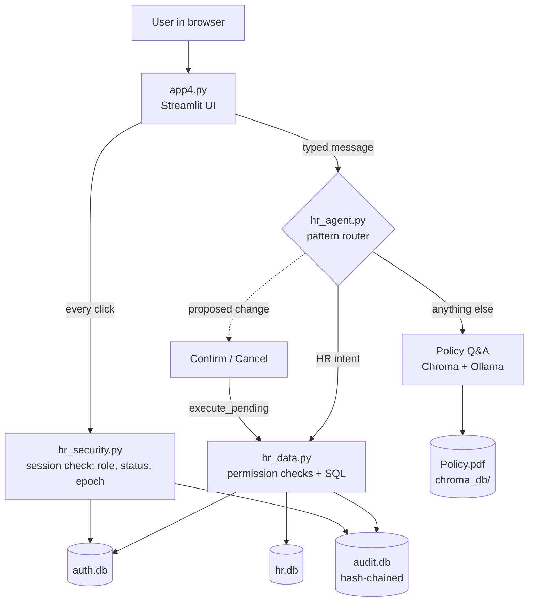

# Architecture

## Overview

| Module | Responsibility |
|---|---|
| `app4.py` | UI, sign-in screens, sidebar, policy upload and index rebuild, policy Q&A call |
| `hr_security.py` | Password hashing, lockout, sessions, TOTP, audit log, file permissions. Stdlib only |
| `hr_data.py` | Schema, synthetic data, leave rules, every read and write of HR data, with permission checks |
| `hr_agent.py` | Chat message to action, confirmation flow, output sanitising, rate limiting |
| `manage.py` | Operator-only tasks (reset password / MFA, unlock, verify audit log) |

## Data model

- `auth.db` / `employees`: login identity, role (`employee`, `manager`, `hr_admin`), manager, active flag, password hash, session epoch, MFA fields.
- `hr.db` / `employee_profile`: email, phone, department, title, location, hire date, address, emergency contact, pay band.
- `hr.db` / `leave_requests`, `leave_allotments`, `holidays`.
- `audit.db` / `audit_log`: append-only (database triggers), each row hashed with the previous row's hash.

`hr.db` attaches `auth.db` so that a change touching both (for example deactivating a person) is one transaction.
Name, role, manager and active status live only in `auth.db`; they are never duplicated.

## Request flow for a chat message

1. `sync_session()` re-reads the user from `auth.db` (role, active, session epoch) and checks idle/absolute timeouts.
2. Length and rate limits are applied.
3. `hr_agent.handle()` matches the message against fixed patterns. A match produces either a read-only answer or a
   *pending action* held server-side in the session, with an expiry.
4. The user confirms with a button (or "yes"). `execute_pending()` re-checks the actor and calls `hr_data`, which
   re-checks permissions, validates input, writes, and records an audit entry.
5. If nothing matches, the message goes to the policy Q&A pipeline, and the model's answer is sanitised before display.

## Security model

**The language model never touches HR data.** It only answers policy questions. Actions come from the user's own
typed message via fixed patterns, so instructions hidden in a PDF, or in model output, cannot trigger a change.

| Threat | Control |
|---|---|
| Stolen or guessed passwords | PBKDF2-SHA256 (600k rounds), 12+ character policy, progressive lockout, optional TOTP |
| Account discovery | Same message and equal CPU cost for unknown and known IDs; lockout tracked per ID string |
| Stale privileges | Role and status re-read on every interaction; password change and deactivation end other sessions |
| Privilege escalation via chat | Permissions enforced in `hr_data.py`, not in the UI or the model; roles and passwords not editable from chat |
| Self-dealing | Nobody approves their own leave; HR cannot change their own title, manager, status or pay band |
| Prompt injection | Policy text delimited and declared as data; history and input capped; no model-driven actions |
| Data exfiltration through rendered output | Images, links, URLs and HTML removed from model output; database values markdown-escaped |
| Malicious uploads | Size, magic-byte and page limits; unique temp file; indexed before replacing the live file |
| Losing the knowledge base | New index built in a new collection and activated atomically |
| Silent tampering | Append-only audit log with hash chain; `manage.py verify-audit` |

### Out of scope / known limits

TLS and per-IP rate limiting belong in a reverse proxy. Files are protected by permissions, not encryption.
The audit hash chain is tamper-evident, not tamper-proof, against someone with write access to the server.
